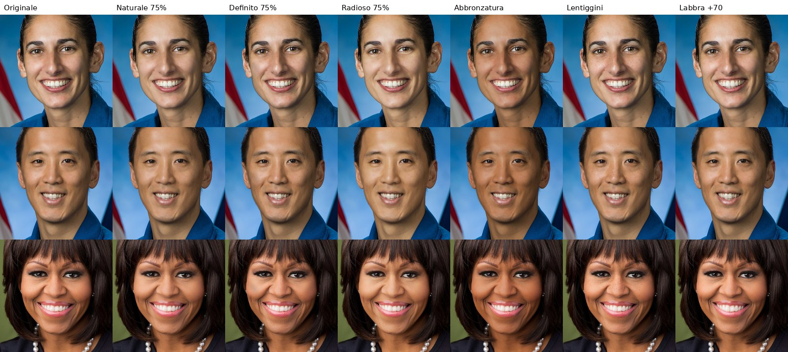

# Volto Studio

Editor fotografico del volto con tre sezioni: **Impressioni**, **Pelle** e **Tratti**. Ogni modifica è graduale, resta localizzata nella zona su cui agisce e lavora sul volto della foto (non lo sostituisce), così la persona resta riconoscibile. Tutto viene elaborato sul dispositivo: la foto non viene caricata su nessun server.



*Foto di esempio: ritratti ufficiali NASA e della Casa Bianca, di pubblico dominio (Wikimedia Commons).*

## Cosa c'è

| Sezione | Strumenti |
|---|---|
| **Impressioni** | Naturale, Delicato, Definito, Radioso, Sofisticato, Armonioso, Espressivo. Intensità continua da 0 a 100% |
| **Pelle** | Abbronzatura (intensità, sottotono caldo/freddo), Lentiggini (quantità, dimensione, intensità, distribuzione), Texture (imperfezioni, uniformità, rossori, pori), Luce (luminosità, pelle radiosa, sottotono) |
| **Tratti** | Naso (larghezza, punta, narici, lunghezza, definizione), Zigomi (definizione, volume, scolpitura), Mandibola (definizione, larghezza, lunghezza e larghezza del mento), Labbra (volume, rapporto superiore/inferiore, larghezza), Occhi (dimensione, forma, distanza, zona perioculare), Sopracciglia (forma, spessore, arco, posizione), Viso (larghezza, terzo inferiore, contorni) |

Ogni cursore parte dal valore neutro, che corrisponde alla foto originale, e ha il proprio pulsante per tornare a quel valore. Ogni strumento ha anche **Annulla**, che toglie solo l'ultima modifica di quello strumento, e **Ripristina**. La barra in alto ha annulla e ripeti globali. Sopra la foto ci sono:
- il confronto tenendo premuto;
- il divisore prima/dopo;
- lo zoom sul volto (oltre a pizzico, rotellina e doppio tocco);
- il ritorno all'originale.

L'esportazione è alla risoluzione piena, fino a 4096 px. Su telefono apre il foglio di condivisione, da cui si salva nella galleria.

## Come avviarla

È un'app web statica, senza compilazione:

```bash
cd studio
python3 -m http.server 8080     # oppure: npx http-server -p 8080
```

Apri http://localhost:8080. Al primo avvio servono una connessione e circa 20 MB per i modelli MediaPipe, che poi restano nella cache del browser. Richiede WebGL2: Safari 15+ su iOS, Chrome o Firefox recenti.

Dal branch `main` del repository viene pubblicata automaticamente su GitHub Pages (`.github/workflows/pages.yml`).

## Come funziona

```
foto ─► MediaPipe Face Landmarker (478 punti) ─┐
     └► MediaPipe Selfie Multiclass (capelli,  ├─► maschere e mappe nello spazio dell'originale (una volta per foto)
        pelle viso/corpo, sfondo)              ┘        │
                                                        ▼
stato (cursori + impressione) ─► parametri ─► shader WebGL2, un'unica passata per ogni render:
                                                1. deformazione inversa (maniglie anatomiche)
                                                2. separazione in frequenze della pelle
                                                3. pelle, chiaroscuro dei tratti, luce, abbronzatura
```

Il codice è separato in livelli:

| Livello | File | Ruolo |
|---|---|---|
| Interfaccia | `src/app/app.js`, `viewer.js`, `index.html`, `style.css` | pannelli, cursori, zoom, confronto |
| Stato e cronologia | `src/app/tools.js`, `history.js` | catalogo degli strumenti e delle impressioni, annulla/ripeti non distruttivo |
| Gestione foto | `src/app/photo.js`, `export.js` | decodifica, copia di lavoro e copia ad alta risoluzione, esportazione |
| Motore fotografico | `src/engine/*.js` | maschere, deformazioni, lentiggini, shader |
| Modelli di visione | `src/vision.js` | caricamento ed esecuzione di MediaPipe |

### Modifiche graduali, localizzate e rispettose dell'identità

- **Graduali.** Ogni strumento è una funzione lineare del suo cursore. Gli spostamenti e le correzioni di colore vengono moltiplicati per il valore, quindi lo 0 restituisce l'originale (verificato al pixel) e il 50% vale esattamente metà del 100% (verificato sugli spostamenti dei punti). Le impressioni sono "ricette" di più parametri scalate insieme, quindi ogni livello è la stessa trasformazione con una forza diversa, non un'immagine diversa.
- **Localizzate.** La geometria è fatta di *maniglie* ancorate ai punti anatomici. Ogni maniglia ha un'area ellittica orientata come il volto e uno spostamento che si annulla gradualmente ai bordi, con un nucleo (1 − u²)³. Il naso sposta solo i pixel attorno al naso, e così via. Gli effetti di pelle usano maschere semantiche: occhi, labbra, interno della bocca, capelli e sfondo sono esclusi.
- **Senza pieghe né doppie linee.** L'ampiezza di ogni maniglia è limitata rispetto al suo raggio, così la deformazione resta invertibile. Lo shader la inverte con iterazioni di punto fisso e campiona l'originale una sola volta. Le maschere sono nello spazio dell'originale e si deformano insieme ai pixel, quindi restano allineate.
- **Pelle senza effetto plastica.** Separazione in tre bande (dettaglio fine, medio, basso) calcolata solo sui pixel di pelle: la sfocatura è pesata sulla maschera, quindi occhi e capelli non fanno alone. Le imperfezioni agiscono soprattutto sulla banda media e sulle macchie scure, mentre i pori restano. Rossori e uniformità lavorano sui canali di crominanza (YCbCr).
- **Prospettiva.** Con la testa girata il lato lontano appare compresso. Le maniglie si ridimensionano in base alla semi-larghezza del proprio lato, così la stessa modifica dà lo stesso effetto anatomico su entrambi i lati. La "simmetria" dell'impressione Armonioso agisce solo sui lineamenti interni e attenua la componente orizzontale, che con la testa girata è falsata dalla prospettiva.
- **Tutte le carnagioni.** Schiarire usa un guadagno che conserva tinta e saturazione (aggiungere bianco renderebbe grigiastre le pelli scure). L'abbronzatura è moltiplicativa: conserva ombre e texture.

## Modelli e API

| Componente | Uso | Licenza | Dove gira |
|---|---|---|---|
| [MediaPipe Face Landmarker](https://ai.google.dev/edge/mediapipe/solutions/vision/face_landmarker) (`@mediapipe/tasks-vision` 0.10.14) | 478 punti del volto | Apache 2.0 | dispositivo (WebAssembly + GPU) |
| [MediaPipe Image Segmenter, selfie multiclass 256×256](https://ai.google.dev/edge/mediapipe/solutions/vision/image_segmenter) | capelli, pelle del viso e del corpo, sfondo | Apache 2.0 (scheda del modello) | dispositivo |
| Modello canonico del volto MediaPipe | coppie speculari dei punti (calcolate una volta e incluse nel codice) | Apache 2.0 | — |

Non è usato alcun modello generativo e nessuna API esterna a pagamento. Prima di un uso commerciale, verifica le licenze sulle pagine ufficiali.

## Costi

- **Elaborazione:** zero. Tutto avviene sul dispositivo dell'utente.
- **Hosting:** zero su GitHub Pages (repository pubblico). I modelli arrivano dai CDN pubblici di jsDelivr e Google.
- **Impressioni "HD" generative (non ancora sviluppate, vedi il piano):** costo per immagine dell'API scelta (ad esempio Gemini 2.5 Flash Image, circa 0,04 $ per immagine al momento della mia ultima verifica), più un piccolo server intermedio che custodisce la chiave API.

## Limiti conosciuti

- **Niente IA generativa:** il motore sposta, ridistribuisce e ricolora i pixel esistenti, ma non ne crea di nuovi. Cambiamenti strutturali molto marcati (zigomi molto più alti, denti, capelli) non sono possibili; l'intensità massima è tarata per restare credibile.
- **Un volto per foto:** se ce ne sono più, si modifica il più grande.
- **Occlusioni:** con mani, oggetti o capelli davanti al viso, i punti nascosti sono stimati dal modello. Nella foto di test con le mani davanti alla bocca, l'ingrandimento degli occhi introduce un'asimmetria di circa 1,3 px (unico controllo fallito su 954).
- **Angolazione:** le pose di profilo (oltre circa 30°) non sono un caso d'uso supportato.
- **Foto in bianco e nero:** tutto funziona, ma gli effetti di colore (abbronzatura, sottotono) restano ovviamente monocromatici.
- **Test su dispositivi reali non ancora fatti:** i test girano su Chromium con WebGL software. Il tempo di render misurato lì (150–330 ms a 1600 px) è un limite superiore; su una GPU di telefono ci si aspetta un render fluido mentre si muove il cursore, ma va misurato.

## Test

```bash
npm install playwright        # una volta
node tests/run-tests.mjs      # qualità del motore su 9 foto (scaricate da tests/images.json)
node tests/ui-smoke.mjs       # percorso utente completo su un telefono simulato
```

`run-tests.mjs` esegue 106 controlli numerici per foto (dettaglio in [docs/risultati-test.md](docs/risultati-test.md)):
- **neutralità:** cursori a zero = originale, al pixel;
- **località:** meno dell'1% dei pixel cambiati fuori dalla zona di ogni tratto;
- **protezione:** occhi, bocca, capelli e sfondo intatti con gli strumenti della pelle;
- **progressione:** intensità crescente e linearità esatta delle impressioni;
- **identità:** spostamento massimo dei punti ≤ 3,5% della larghezza del viso;
- **pieghe:** assenza di pieghe (Jacobiano);
- **asimmetria:** nessuna asimmetria aggiunta.

Le 9 foto di test hanno licenze libere (pubblico dominio o CC BY-SA, autori in `tests/images.json`). Coprono carnagioni da chiara a molto scura, età diverse, una foto con la testa inclinata, due in bianco e nero, luce laterale e un volto parzialmente coperto.

**Risultato attuale: 953 controlli superati su 954** (8 foto al 100%, la nona con il limite di occlusione descritto sopra). `ui-smoke.mjs` verifica:
- caricamento;
- impressione al 75%;
- abbronzatura e lentiggini;
- labbra;
- Annulla dello strumento e annulla globale;
- Ripristina;
- confronto prima/dopo;
- zoom;
- esportazione a piena risoluzione;
- assenza di errori JavaScript.

## Piano per le funzioni da sviluppare

1. **Test su iPhone e Android reali:** tempi di render, memoria con foto da 12 MP, comportamento dei gesti.
2. **Impressioni HD generative (opzionali, a pagamento):** un server intermedio con la chiave API chiama un modello di image editing commerciale, solo sulla zona del volto. Per l'intensità, il risultato al 100% viene scomposto in due parti:
   - *geometria*: lo spostamento dei 478 punti, riapplicato a α × 100% con le maniglie;
   - *aspetto*: colore e texture, confrontati dopo aver riportato il risultato sulla forma originale e fusi in proporzione α.

   Per costruzione, le due immagini allineate non producono doppi contorni.
3. **Metrica di identità basata sul riconoscimento facciale**, per i test interni. Serve un modello con una licenza compatibile: quelli di InsightFace, per esempio, sono solo per ricerca.
4. **Più volti nella stessa foto**, con la scelta del volto da modificare.
5. **Pacchetto per gli store** (Capacitor) e salvataggio diretto in galleria.
6. **Altri strumenti di pelle già previsti dall'architettura:** occhiaie dedicate, opacizzazione della lucidità, contouring personalizzato. Per aggiungerne uno basta una voce in `tools.js` e un termine nello shader.
